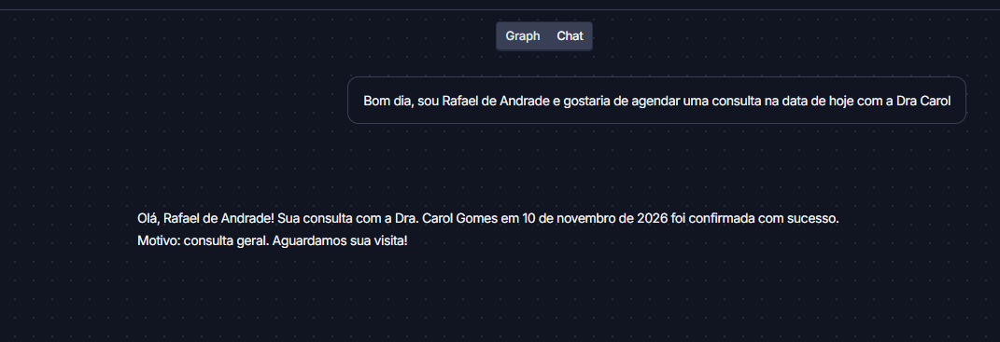
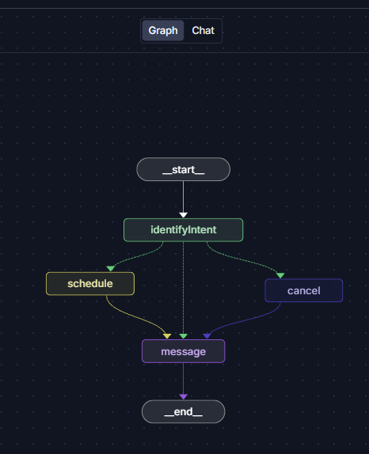
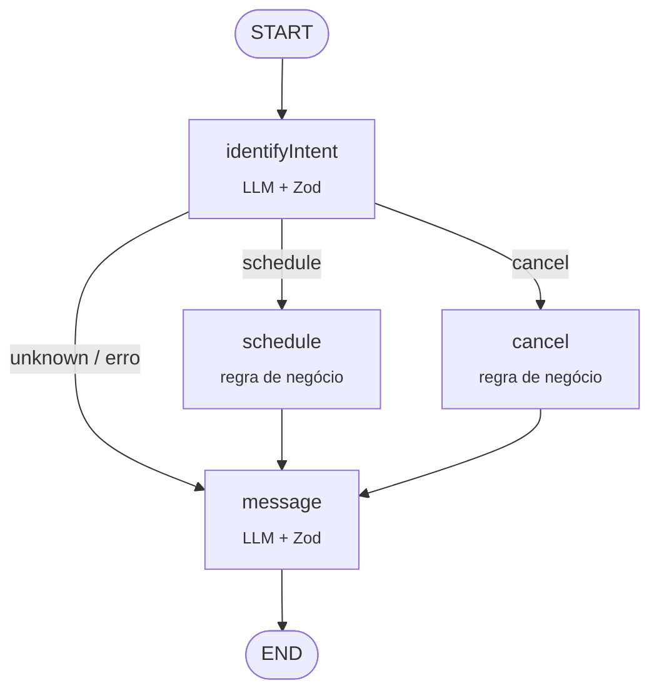

<div align="center">

# 🩺 Agente de Agendamento Médico

**O paciente escreve como fala. O agente entende, agenda ou cancela, e responde como uma recepcionista.**


</div>

---

Marcar consulta ainda depende de formulário com cinco campos, telefone ocupado ou alguém lendo WhatsApp. Aqui, uma frase basta:

> *"Bom dia, sou Rafael de Andrade e gostaria de agendar uma consulta na data de hoje com a Dra Carol"*

O agente descobre a **intenção**, extrai **paciente, profissional, data e motivo**, valida tudo com schema, executa a ação na agenda e devolve uma confirmação em linguagem natural. Se faltar dado ou o horário estiver ocupado, ele explica o motivo em vez de quebrar.

<div align="center">
  
</div>

## Como o agente decide

O fluxo é um **grafo de estados** (LangGraph). O LLM entra só onde ele é bom, que é entender e escrever texto. Quem agenda e cancela é código determinístico.

<table>
<tr>
<td width="45%" align="center">
  
</td>
<td>



</td>
</tr>
</table>

| Nó | Responsabilidade |
|---|---|
| `identifyIntent` | Classifica a intenção (`schedule`, `cancel`, `unknown`) e extrai os campos. Datas relativas como "amanhã às 16h" viram ISO, e "Dra Carol" é casada com o ID da Dra. Carol Gomes |
| `schedule` / `cancel` | Revalidam os campos obrigatórios com Zod e chamam o `AppointmentService`. Conflito de horário e consulta inexistente viram erro tratado, sem exceção solta |
| `message` | Gera a resposta ao paciente a partir do cenário (`schedule_success`, `cancel_error`...), no tom de uma recepcionista |

## Destaques técnicos

- **Saída estruturada em vez de texto livre.** Todo retorno do LLM passa por um schema Zod (`providerStrategy`). Se o modelo inventar um campo ou faltar `professionalId`, o grafo segue pelo caminho de erro e não grava nada errado na agenda.
- **LLM separado da regra de negócio.** O modelo extrai e redige; quem decide se o horário está livre é o `AppointmentService`. Uma alucinação não vira consulta marcada.
- **Roteamento condicional.** `addConditionalEdges` manda cada pedido para o nó certo. Pergunta fora do escopo ("como está o tempo?") vai direto para uma resposta educada, sem gastar chamada à toa.
- **Prompts versionados como código.** Ficam em `src/prompts/v1/`, em JSON estruturado com regras, exemplos few-shot e `current_date` injetada. Dá para criar uma `v2` sem tocar nos nós.
- **Falha não derruba a API.** Cada nó tem `try/catch` e devolve estado parcial com `actionError`, então o paciente sempre recebe uma mensagem.
- **Testes E2E com LLM real.** `node:test` + `fastify.inject` cobrem agendamento e cancelamento ponta a ponta, sem mock do modelo.
- **Observável.** Tracing via LangSmith e grafo inspecionável no LangGraph Studio.

## Rodando local

Requer **Node.js 24.10+** (roda TypeScript nativo, sem build) e uma chave da [OpenRouter](https://openrouter.ai/keys).

```bash
npm install
cp .env.example .env   # preencha OPENROUTER_API_KEY (LangSmith é opcional)
npm start              # API em http://localhost:3000
```

Mande uma mensagem:

```bash
curl -X POST http://localhost:3000/chat \
  -H "Content-Type: application/json" \
  -d '{"question": "Sou Maria Santos e quero agendar com o Dr. Alicio da Silva amanhã às 16h para um check-up"}'
```

A resposta traz o estado final do grafo: `intent`, `actionSuccess`, os dados extraídos e, em `messages`, a confirmação escrita pelo agente.

<details>
<summary><b>Abrir no LangGraph Studio (visualizar o grafo e conversar pelo chat)</b></summary>

```bash
npm run langgraph:serve
```

O CLI imprime a URL do Studio. Lá dá para ver o grafo, executar passo a passo e inspecionar o estado de cada nó. Os prints deste README foram tirados de lá.

</details>

<details>
<summary><b>Profissionais disponíveis na agenda de exemplo</b></summary>

| ID | Profissional | Especialidade |
|---|---|---|
| 1 | Dr. Alicio da Silva | Cardiologia |
| 2 | Dra. Ana Pereira | Dermatologia |
| 3 | Dra. Carol Gomes | Neurologia |

A agenda é em memória (`src/services/appointmentService.ts`) e já começa com duas consultas, o que permite testar conflito de horário.

</details>

## Testes

```bash
npm run test:e2e
```

Os testes sobem o servidor em memória e fazem chamadas reais ao modelo, cobrindo agendamento com sucesso e agendamento seguido de cancelamento. Como dependem do LLM, precisam da `OPENROUTER_API_KEY` configurada.

## Estrutura

```
src/
├── index.ts                    # sobe o Fastify na porta 3000
├── server.ts                   # rota POST /chat → graph.invoke()
├── config.ts                   # modelo, temperatura, roteamento OpenRouter
├── graph/
│   ├── graph.ts                # StateGraph, schema do estado e arestas condicionais
│   ├── factory.ts              # injeta dependências (também usado pelo LangGraph Studio)
│   └── nodes/
│       ├── identifyIntentNode.ts
│       ├── schedulerNode.ts
│       ├── cancellerNode.ts
│       └── messageGeneratorNode.ts
├── prompts/v1/                 # system/user prompts + schemas Zod
└── services/
    ├── openRouterService.ts    # LangChain + OpenRouter com structured output
    └── appointmentService.ts   # agenda: disponibilidade, agendar, cancelar
tests/
└── router.e2e.test.ts
```

## Stack

| Camada | Tecnologia |
|---|---|
| Orquestração | LangGraph (`StateGraph`, arestas condicionais) |
| LLM | LangChain + OpenRouter (`createAgent` + `providerStrategy`) |
| Validação | Zod |
| API | Fastify 5 |
| Runtime | Node.js 24 com TypeScript nativo |
| Observabilidade | LangSmith + LangGraph Studio |
| Testes | `node:test` + `fastify.inject` |

## Próximos passos

- [ ] Persistir a agenda em banco (hoje é em memória)
- [ ] Memória de conversa com checkpointer, para o agente pedir o dado que falta e continuar de onde parou
- [ ] Consultar horários livres ("quais horários a Dra. Ana tem amanhã?")
- [ ] Reagendamento como intenção própria

## Contexto

Projeto desenvolvido na **Pós-graduação em Engenharia de IA Aplicada** (UNIPDS), com [Erick Wendel](https://github.com/ErickWendel). O ponto de partida foi o template da aula; a implementação dos nós, prompts, schemas e testes é minha.

---

<div align="center">

Feito por **Rafael de Andrade**

</div>
